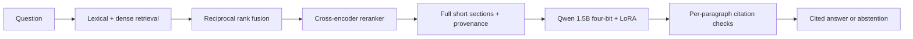

# Australian Regulatory AI Assistant

A local, model-backed research assistant with hybrid retrieval, reranking, cited
MLX answers, a measured LoRA experiment, and a dark chatbot interface. The active corpus contains **37 statutory sections**, indexed
as **93 passages**, from Schedule 2 of the Competition and Consumer Act 2010.

[Open the GitHub Pages application](https://satyampalkar.github.io/Australian-Regulatory-AI-Assistant/).
The public Pages version searches the bundled corpus entirely in your browser and
shows the saved model experiment. Run the local API for actual LLM generation.

## Measured on an M3 Pro

The frozen synthetic test contains 24 supported and 12 unsupported questions. Its
source sections are disjoint from the training sections; it is not an independently
reviewed legal benchmark.

| Pipeline | Expected source in top 3 | Supported questions answered | Unsupported questions declined |
| --- | --- | --- | --- |
| TF-IDF passages | 22/24 | 24/24 passages returned | 11/12 |
| Hybrid + reranker passages | 23/24 | 21/24 passages returned | 12/12 |
| Base Qwen + RAG | 23/24 | 17/24 cited answers | 12/12 |
| LoRA Qwen + RAG | 23/24 | 20/24 cited answers | 12/12 |

A response passing citation checks is **not a verified correct answer**. The small
LoRA experiment improved response acceptance on this test; factual correctness and
citation entailment remain ungraded. Median LoRA RAG latency was 0.97 seconds and
peak MLX allocation was 1.94 GB. The 60-step training run took 49.6 seconds with
2.32 GB peak MLX allocation. These figures describe one machine and experiment.

[Full comparison and failures](reports/comparison.md) · [Experiment protocol](EXPERIMENTS.md) · [Model card](MODEL_CARD.md)

## Run the model-backed app on your Mac

Tested with Python 3.13, macOS 15.6.1, Apple M3 Pro and 18 GB unified memory.
Model downloads total approximately 1 GB. No paid API or API key is needed.

```sh
python3.13 -m venv .venv
source .venv/bin/activate
python -m pip install -r requirements-macos.lock
python scripts/download_models.py
python -m reg_assistant.cli index --backend hybrid --output data/index-hybrid.json
python scripts/train_lora.py --smoke
python scripts/train_lora.py
cd site
npm run install:ci
npm run build:pages
cd ..
python -m reg_assistant.cli serve
```

Open **http://127.0.0.1:8000/Australian-Regulatory-AI-Assistant/**. The local server
selects hybrid retrieval and the trained adapter automatically. Use `serve
--base-model` to compare the unadapted model. The server binds to loopback and
processes one question at a time; it is a local research service.

The trained adapter and model weights stay outside Git. Anyone cloning the repo
can reproduce them with the commands above. Existing adapters are protected from
accidental overwrite. The dependency snapshot is specific to the tested Mac stack;
the lightweight TF-IDF baseline below still runs with Python 3.9 and no packages.



## Real dataset and Sydney coverage

The statutory text comes from [cchew/lex-au on Hugging Face](https://huggingface.co/datasets/cchew/lex-au),
an Akoma Ntoso XML conversion of Commonwealth legislation. The import is pinned to
revision `ce532ddeb514fa477d6466a892fa17e62d21513e`; both downloaded files are checked
against SHA-256 hashes. The source compilation is **C2026C00389, 27 August 2026**.

The collection covers consumer guarantees, misleading conduct, unfair contract
terms, repairs and refunds, and remedies against suppliers and manufacturers.
These are selected national consumer-law provisions relevant to Sydney and NSW.
State-only Acts, council by-laws, tribunal fees and practical complaint-handling
guidance are outside the collection.

The official register listed a newer Act compilation, **C2026C00405, 16 September
2026**, when checked on 28 October 2026. Changes to the selected sections have not
been compared. The app labels the dataset snapshot and links to the official law.

Copyright remains with the Commonwealth of Australia. The dataset is distributed
under CC BY 4.0. This project selects sections, removes XML markup, normalises
whitespace and adds retrieval metadata. See [data/ATTRIBUTION.md](data/ATTRIBUTION.md).
The separate `data/demo.jsonl` retains the original authored ACCC summaries for
historical tests; those summaries are not the active hosted corpus.

## Run locally

Python 3.9+ is sufficient; the statutory extract is bundled and no installation or
network is required for the lexical baseline. Run from this directory:

```sh
python3 -m reg_assistant.cli index
python3 -m reg_assistant.cli ask "What guarantee applies to services supplied with due care and skill?"
python3 -m reg_assistant.cli evaluate
python3 -m unittest discover -s tests -v
```

The default documents are `data/consumer_law.jsonl`. Evaluation uses
`eval/consumer-law-dev.jsonl` and writes `reports/consumer-law-baseline.json`.
Use `ask --json` to inspect source metadata and retrieval scores.

To reproduce the import from Hugging Face, including its raw source files:

```sh
python3 scripts/import_huggingface.py
python3 -m reg_assistant.cli index
python3 -m reg_assistant.cli evaluate
python3 scripts/export_site_data.py
```

The importer uses `data/huggingface_sources.json`, caches pinned files under ignored
`data/raw/huggingface/`, and replaces the corpus only after checksums, law-version
metadata and every selected section have been verified. A new dataset revision
requires a reviewed manifest update with new checksums and a fresh evaluation.

## Browser interface

Node.js 24 is required:

```sh
cd site
npm run install:ci
npm run build:pages
npm run preview:pages
```

Open `http://127.0.0.1:4174/Australian-Regulatory-AI-Assistant/`. The interface includes cited passages, a searchable
statutory section library, version/licence details, research exports and the saved
development evaluation. GitHub Pages runs the same TF-IDF engine locally in the
browser; questions require no backend or API keys. Pushes to `main` trigger the
Pages build and deployment workflow. GitHub Pages itself does not run an LLM or adapter.
The mode control can connect a running API; the same-origin local URL above is the
recommended model-backed experience. Browser security policies may restrict remote
Pages-to-localhost connections.

The optional Worker deployment and its API remain supported: `npm run dev` serves
that variant at `http://localhost:5173`. See [DEPLOYMENT.md](DEPLOYMENT.md) for both
hosting targets, browser QA and publication details.

## Evaluation and limits

The development set contains nine supported and three unsupported questions.
The expected section was first for **7/9**, within the top three for **9/9**, and
**2/3** unsupported questions triggered abstention. The visa question is a known
answerability failure. This inspected set is not a held-out test or a legal
accuracy benchmark.

The app displays retrieved statutory passages with citations. It does not decide
legal outcomes. Source presence, keywords and valid citation numbers do not prove
that a passage answers a question or that a conclusion is legally correct.
Qualifying subsections can occur outside a retrieved chunk: always consult the
complete provision and its current official version.

TF-IDF uses a 0.16 similarity threshold and a minimum 0.5 vocabulary-coverage scope
heuristic to reduce relevance inflation from unknown query terms. These are
development settings, not calibrated confidence scores. Semantic mode starts at
0.40 cosine similarity. Tune only on development data.

The exporter refuses a mismatched corpus, changed questions, or an evaluation with
answers that differ from the current retrieval behavior. The GitHub CI workflow
checks deterministic exports, Python/web tests, types and the production build.

## Model stack and reproducibility

The new hybrid pipeline uses the pinned models in `configs/models.json`:

- `sentence-transformers/all-MiniLM-L6-v2` for dense retrieval, combined with TF-IDF
  through reciprocal rank fusion over 12 candidates.
- `cross-encoder/ms-marco-MiniLM-L6-v2` for relevance reranking and a 0.5 sigmoid
  threshold. This threshold is a development setting, not answer confidence.
- `mlx-community/Qwen2.5-1.5B-Instruct-4bit` for greedy generation, capped at 256
  output tokens, with optional four-layer rank-four LoRA adapters.

CPU embedding/reranking uses float64 and eager attention because float32 CPU
reranker inference produced NaNs on the tested setup. Non-finite embeddings or
reranker scores cause an error. Short source sections are expanded in full to
preserve qualifications; long sections remain visibly partial evidence. Each
answer paragraph must end with valid supplied reference numbers. This structural
check cannot establish entailment or prevent every hallucination.

```sh
python scripts/run_experiment.py --suite test --modes tfidf hybrid base-rag adapter-rag
python scripts/export_experiments.py
python -m unittest discover -s tests -v
```

The checked-in 36-question test is now observed. Further tuning must use development
data; future independent claims need a new frozen test. See `EXPERIMENTS.md` for
split hashes, training logs, failure analysis and the pending human-review rubric.

For the historical summary baseline, explicitly select `data/demo.jsonl`,
`eval/dev.jsonl` and a separate report path. `reports/dev-baseline.json` records the
earlier summary run and should not be read as current statutory-corpus performance.
